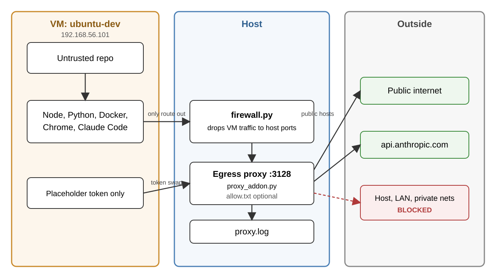

# ShouldNotPass

Run untrusted repos in a disposable VM. The VM reaches the internet through a proxy on your host, but not your host, your LAN or private networks. One script, `snp.py`, does everything.

**Requirements.** Host: Python 3.12+ (mitmproxy needs it), VirtualBox 7.1+, OpenSSH client. VM: Python 3 and npm. The attack suite's Python uses only the standard library; it runs `npm install`, which needs npm.

## What it protects against

- Host and LAN: the host firewall (`firewall.py`) and the proxy block them. The VM has no route out except the proxy.
- Secrets: the VM never holds your Claude token. The proxy swaps in a placeholder.
- Not covered: whatever the VM sends to the internet through the proxy, and anything that escapes the VM itself. Open mode lets the VM reach any public site.

## Quick start

```
python3 snp.py setup        # once, long: builds the VM and installs the tools
python3 snp.py up           # each session: firewall, proxy, VM
python3 snp.py snapshot     # once the VM is right: save it as `clean`
python3 snp.py reset        # after each repo: back to `clean`
```

Global options go before the command, for example `python3 snp.py --dry-run setup` prints the commands without running them. Details: [VM-SETUP.md](VM-SETUP.md).

## Host options

| Option                               | Default                                   | Purpose                                                                                                |
| ------------------------------------ | ----------------------------------------- | ------------------------------------------------------------------------------------------------------ |
| `--state-dir PATH` / `SNP_STATE_DIR` | `.snp/` in the checkout (git-ignored)     | VM disks, installer, SSH keys, proxy CA, private Python runtime. Use the same value for every command. |
| `--name NAME`                        | `ubuntu-dev`                              | Second VM next to the first. Add it to any command.                                                    |
| `--ram MB`                           | 8192                                      | `setup` only. 4096 is enough for a small frontend.                                                     |
| `--cpus N`                           | 4, or the host's count if lower           | `setup` only.                                                                                          |
| `--password X`                       | `dev`                                     | Console login only; SSH is key-only.                                                                   |
| `--iso FILE`                         | first `.iso` in the folder, else download | Ubuntu 26.04.1 image, checksum checked.                                                                |
| `SNP_VBOXMANAGE`                     | found automatically                       | Path to a nonstandard `VBoxManage`.                                                                    |
| `--ca-cert FILE` (repeatable)        | normal trust                              | Public inspection CA, used only by `setup`/`provision`. Never a private key.                           |

### `--state-dir`: where the VM's files go

By default everything lives in `.snp/` inside the checkout. `--state-dir PATH` moves it to another folder, for example a larger drive. The same value (or `SNP_STATE_DIR`) must be used for every command, because the VM disk, SSH key and proxy CA are found through it.

```
python3 snp.py --state-dir /mnt/big/snp setup
python3 snp.py --state-dir /mnt/big/snp up
python3 snp.py --state-dir /mnt/big/snp reset
```

Pass it before the command, like `--dry-run`. Or export `SNP_STATE_DIR=/mnt/big/snp` once and leave the flag off. Windows example: `--state-dir D:\snp` (see Windows below).

The folder is created on the first `setup`, `up`, `provision` or `reset`, and set to owner-only (mode 700; on Windows, private permissions). `snp.py` refuses a drive root, your home folder, the checkout or a folder above it, and a folder that is a git repo.

Use a dedicated state directory: its permissions protect the SSH keys and the proxy CA. `.env` and `allow.txt` stay in the checkout. `.env` can hold `SANDBOX_OAUTH_TOKEN` (from `claude setup-token`).

## Before you start

- VirtualBox 7.1+, Python 3.12+ with the `venv` module (Ubuntu: `sudo apt install python3-venv`), and the OpenSSH client (`ssh`, `scp`, `ssh-keygen`).
- Nothing else to install. `snp.py` puts mitmproxy and psutil in `.snp/venv` on the first `setup` or `up`. That needs internet once, for `pip`.
- About 20 GB free disk (the 60 GB disk file grows as it fills), and 8 GB RAM for the VM.
- Admin rights: the firewall step asks for your sudo password (Linux, macOS) or shows a UAC prompt (Windows) each time you run `setup`, `provision`, `up` or `reset`. No elevated terminal needed. On Windows the prompt can open minimised in the taskbar.
- ARM hosts, including Apple Silicon and Windows on ARM, are not supported yet (needs an arm64 Ubuntu image).

## Platform status

| Platform         | VM  | Firewall         | Status                                                                                                |
| ---------------- | --- | ---------------- | ----------------------------------------------------------------------------------------------------- |
| Linux (nftables) | yes | `nft`            | verified with the attack suite                                                                        |
| Linux (iptables) | yes | `iptables`       | untested                                                                                              |
| Windows 11 x64   | yes | Windows Firewall | VM start, guest isolation, Chrome, Docker and snapshot/reset tested on a real host; firewall untested |
| macOS (Intel)    | yes | `pf`             | CI only, no live VM test                                                                              |
| Apple Silicon    | no  | —                | `setup` stops with a message                                                                          |

The same Python CLI runs on every OS; the firewall backend is picked automatically. The offline CI matrix covers Linux, Windows and macOS.

### Windows

Install VirtualBox, Python 3.12+ and the Windows OpenSSH Client. Use `py -3` in place of `python3`; the firewall step shows a UAC prompt by itself, just as it asks for `sudo` on Linux:

```powershell
py -3 snp.py --state-dir D:\snp setup --ram 4096
py -3 snp.py --state-dir D:\snp up
```

Or run the whole script elevated through the optional PowerShell launcher:

```powershell
.\snp.ps1 -Elevate --state-dir D:\snp setup --ram 4096
.\snp.ps1 -Elevate --state-dir D:\snp up
```

Pick a drive with at least 30 GB free. The launcher finds Python, handles UAC and saves output to `.snp\elevated.log`. If script execution is disabled, run `py -3 snp.py ...` from an administrator terminal. Guest scripts use LF line endings.

Windows firewall rules apply only to the sandbox adapter and persist until `firewall.py down`; `up` verifies them before starting the VM. Keep Windows Firewall enabled. Setup refuses incompatible forwarding, bridging, sharing and firewall policy.

### Extra certificate

If HTTPS inspection needs an extra root, stop the proxy, then run `python3 snp.py --ca-cert /path/to/public-root.crt provision` with the same state options. Use one public PEM or DER CA per file. The proxy and guest OS, Node and Chrome trust it; TLS verification stays on. Machine-specific certificates stay outside Git.

## Layout

The repo is flat for now. Splitting it into folders is planned (see TODO below).

| Part                | Files                                                                                                                                                                   | What it is                                                                                              |
| ------------------- | ----------------------------------------------------------------------------------------------------------------------------------------------------------------------- | ------------------------------------------------------------------------------------------------------- |
| 1. Sandbox          | `snp.py`, `firewall.py`, `proxy_addon.py`, `egress_rules.py`, `netinfo.py`, `windows_host.py`, `snp.ps1`, `setup-dev.sh`, `setup-guest-proxy.sh`, `report-installed.sh` | The VM, host firewall and egress proxy. This is the protection.                                         |
| 2. Attack suite     | `attack-suite/probe.py`, `attack-suite/mock_recruiter.py`, `attack-suite/package.json`, `attack-suite/ATTACK-SUITE.md`, `attack-suite/README.md`                                                                                     | A mock hostile repo. It tries to escape and reports what got out. Test fixture, not malware.            |
| 3. Scan and reports | `scan.py`, `leak_report.py`, `leak-report.md`, `leak-report.html`                                                                                                       | `scan.py` checks a project before you run it. `leak_report.py` turns attack-suite output into a report. |

TODO: move to a folder layout (`sandbox/`, `scan/`, `attack-suite/`) once the flat layout settles. Until then only the attack suite lives in a folder (`attack-suite/`); the rest is flat.

## 1. Sandbox

Build once with `setup`, run with `up`, reset after each repo with `reset`. The VM has no route out except the HTTP proxy on the host. The host firewall drops everything else from the VM, and the proxy refuses private addresses. No shared folders, clipboard or USB.

`setup` creates the host-only network (`192.168.56.0/24`, DHCP, no NAT) and the VM, then installs Ubuntu unattended. The installer needs the mirrors, so that step uses NAT; after it the VM moves to host-only and loses NAT for good. Expect 30 to 60 minutes. Don't click in the VM window, run the Ubuntu updater or power the VM off until `setup` ends.

After the Ubuntu install, `setup` loads the firewall (asks for sudo), starts the proxy and installs the tools over SSH: Node, npm, Python, Chrome, VS Code, Insomnia, Docker, Git and Claude Code. The VM is left powered off.

If the tool install fails, fix the cause and run `python3 snp.py provision`. It repeats the firewall step (another UAC prompt on Windows) and the SSH step. Snap installs are retried because the Snap store can be unreachable at times. Known failures and fixes: [TROUBLESHOOTING.md](TROUBLESHOOTING.md).

Inside the VM, each terminal and ssh login prints the installed tools. To see the list again: `vm-versions`. From the host: `python3 snp.py report`.

Details, firewall per OS, proxy log and the optional `allow.txt`: [VM-SETUP.md](VM-SETUP.md). What the sandbox must do, and what is verified so far: [constraints.md](constraints.md).

## 2. Attack suite

It is a mock hostile repo: `npm install` runs `probe.py` as a postinstall script, as a hostile repo would. It probes and reports only. It reads file names, not contents, and sends nothing sensitive. It has 42 probes (40 without `--gateway`).

Run it from the host, with your router's IP:

```
python3 snp.py probe --gateway 192.168.1.1
```

`snp.py probe` copies the files into the VM and runs them there. It refuses to run anywhere else. The report stays in the VM at `~/probe/probe-report.json`.

**Find your router IP** (the host's default gateway, not the VM's; the VM has no default route):

- Linux: `ip route | grep default`, the address after `via`
- macOS: `netstat -rn | grep default`, the first address
- Windows: `ipconfig`, the "Default Gateway" line

You type the address yourself; nothing scans your network. Without `--gateway` the router probes are skipped and the output says so. Each probe has an expected result; `FAIL` means the sandbox leaked.

To check by hand inside the VM: `SNP_VM=1 python3 probe.py`.

## 3. Scan and reports

Two different questions:

- **Is this project dangerous?** `python3 scan.py PATH` (folder or zip) lists hooks, install scripts, encoded URLs and other red flags before anything runs. Exit code 1 on a high finding.
- **Does the sandbox hold?** Copy the probe report out of the VM, then `python3 -I leak_report.py probe-report.json [--html] > leak-report.md`.

Current result on Linux: 42 probes, 0 leaks. Known and accepted: 4 (open mode lets the VM reach public sites).

## How they connect



The VM reaches the outside only through the host proxy. The host firewall drops all other traffic from the VM, and the proxy refuses private addresses and swaps the Claude token.

The mock malware is the shared fixture. `scan.py` flags it (4 high findings). Run inside the sandbox, it gets no leak (42 of 42 probes as expected).

## TODO: test on other platforms

The code for these exists but has not been run on the platform. Testers wanted.

- [ ] **macOS (Intel):** host-only network setup, adapter names, the `pf` firewall in `firewall.py`, `netinfo.py`.
- [ ] **Linux with iptables** instead of nftables: the iptables path in `firewall.py`.
- [ ] **Windows 11:** the Windows Firewall rules in `firewall.py`.
- [ ] **Apple Silicon:** arm64 Ubuntu image support.
- [ ] **Attack suite gaps:** IPv6, DNS and UDP around the proxy, a proxy-down test, and a check that `reset` removes planted files.

## Tests

```
python3 test_snp.py
python3 test_scan.py
.snp/venv/bin/python test_egress_rules.py
.snp/venv/bin/python test_credential_swap.py
```

The `test_*.py` scripts listed in `.github/workflows/tests.yml` mock VM, SSH and firewall operations. Run them with the private venv's Python (`.snp\venv\Scripts\python.exe` on Windows).
